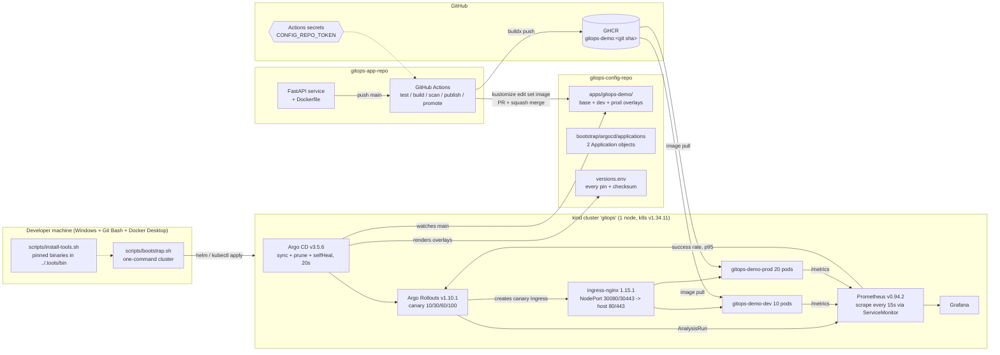
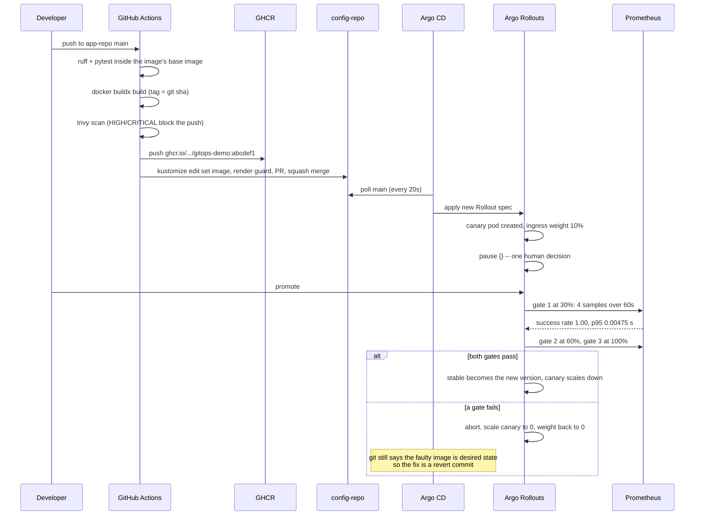

# Architecture

One service, two repositories, one cluster, four tools. This document is the
version of the project that does not need the code open to be understood: what
each component is for, what crosses which boundary, and where the measured
numbers come from.

## System view

What is missing from that diagram is the point: **nothing between a commit and a
running pod is a human**, and **nothing that writes to the cluster is CI**. The
only path into the cluster is a merged commit in config-repo.

## A release, step by step

## Measured numbers

From real runs on this cluster, not from documentation.

| What | Measured | Notes |
|---|---|---|
| CI: commit → image published + PR merged | **~90 s** warm, ~4 min cold | buildx layer cache is the difference |
| Merged config-repo commit → Argo CD acts on it | **5 m 21 s** before the fix, **~3 s** after | see "the two ConfigMaps" below |
| Canary 10% (promoted) → Healthy at 100% | **4 m 34 s** | three 30 s soaks + three gates of 4×15 s |
| One gate: 4 samples | **~49 s** | `interval: 15s`, `count: 4` |
| p95 measured on a healthy canary | **0.00475 s** (4.75 ms) | threshold is 0.5 s |
| Success rate on a healthy canary | **1.00** | threshold is 0.99 |
| Load generated during one release | **~34 000 requests** at 20 rps per environment | transport errors: 26 of 34 013 |
| Hand-patched ConfigMap → reverted by selfHeal | **3 s** | one reconciliation cycle |

## Component inventory and why each one is there

| Component | Pinned version | Role | If it were removed |
|---|---|---|---|
| kind | v0.33.0, node image v1.34.11 | the cluster | nothing runs |
| ingress-nginx | chart 4.15.1 / app 1.15.1 | the traffic switch: it *is* the canary splitter | `trafficRouting.nginx` has nothing to annotate; a canary that scales pods but routes no traffic proves nothing |
| kube-prometheus-stack | chart 92.17.0 / Prometheus v0.94.2 | the only objective input the gate has | the AnalysisTemplate has no data source, so every release either fails open or fails shut |
| Argo CD | v3.5.6 | desired state → live state, continuously | deploys become an event, not a state; drift cannot be detected |
| Argo Rollouts | v1.10.1 | progressive delivery + abort/rollback | Argo CD would replace all 30 pods at once |
| Kustomize | v5.8.3 | base + two overlays | Helm would do it with more machinery for a three-value diff |
| Trivy | v0.76.1 | blocks the *push*, not merely the deploy | a vulnerable layer becomes pullable, and something pulls it |
| GitHub Actions | runner `ubuntu-24.04` | the only thing that writes an image | a laptop becomes the build server |

## Boundaries and who may cross them

| Boundary | Who may cross | With what |
|---|---|---|
| app-repo `main` | a human, or CI pushing nothing | `git push`, `GITHUB_TOKEN` for the PR |
| GHCR `gitops-demo` | CI only | built-in `GITHUB_TOKEN`, `packages: write` |
| config-repo `main` | CI (promotion PRs) and humans | fine-grained PAT, `Contents: RW` + `Pull requests: RW`, one repository |
| the cluster, application resources | **Argo CD only** | its own in-cluster ServiceAccount |
| the cluster, infrastructure | `bootstrap.sh`, by hand | the kubeconfig kind writes |
| namespaces `gitops-demo-*` | created by Argo CD (`CreateNamespace=true`) | so the namespace itself is under git |

The asymmetry is deliberate. Argo CD's `default` project is unrestricted here;
the restriction that matters is procedural and enforced by review: if it is not a
merged commit in config-repo, it does not exist in production.

## Two things that look like bugs and are load-bearing

**`ignoreDifferences` on `/spec/selector` of the two traffic Services.** Argo
Rollouts rewrites each Service's selector to a `rollouts-pod-template-hash` so
stable and canary traffic are physically separated. Git still says
`app: gitops-demo`, so Argo CD sees drift every time a step changes. Without the
two entries, selfHeal pushes the selector back within 20 seconds, both Services
select every pod, the canary receives 100% of traffic, and the release you are
watching is broken by the tool that is supposed to protect it.

**The load generator.** `AnalysisTemplate` queries return an empty result when a
pod has served nothing. An empty result is a failed measurement, `failureLimit: 0`
makes that an `Error`, and the rollout aborts a release that was never measured at
all. A canary analysis without traffic is not a conservative system, it is a
random one. `scripts/loadgen.py` also deliberately excludes `/metrics`, so
Prometheus scraping the app cannot add 200s that dilute the success rate.

## The ConfigMap that was not the one

`bootstrap.sh` sets the reconciliation interval to 20 s so a push is followed by
visible activity instead of three dead minutes. Argo CD's documentation lists
`timeout.reconciliation` as a key of `argocd-cmd-params-cm`, so that is what the
script patched. The install manifest, however, wires the controller's
`ARGOCD_RECONCILIATION_TIMEOUT` from **`argocd-cm`**, `optional: true`. The key was
set, the reference resolved to nothing, and the controller kept its 180 s default.

Measured before the fix: a commit merged at 15:50:30 was acted on at 15:55:51 —
5 m 21 s. After patching both ConfigMaps: a hand-patched ConfigMap reverted in 3 s.

The lesson that generalises: *a ConfigMap key is not a behaviour.* The script now
reads the value back from the running process (`/proc/1/environ`) and warns if it
is not what was asked for, because neither the StatefulSet nor the Pod spec shows
a resolved `configMapKeyRef`.

## Failure modes, and what the system does about each

| Failure | Detection | Response |
|---|---|---|
| Latency regression in a release | p95 gate at 30%, 4 samples | abort, canary to 0, weight back to stable, no human needed |
| Error regression | success-rate gate | same |
| Canary pod crash-loops | readiness probe fails, Service has no endpoints | gate sees no traffic → empty result → `Error` → abort |
| Prometheus down or still starting | AnalysisRun errors | release does not promote; it fails shut, which is the safe direction |
| No traffic during a release | empty query result | abort — so the operator must run loadgen, and the demo says so |
| Hand edit in an app namespace | reconciliation diff | selfHeal reverts in one cycle (measured 3 s) |
| Hand edit in infrastructure | **none** | out of band, not in git, invisible — stated as a limit, not hidden |
| CI cannot reach config-repo | `403 denied to github-actions[bot]` | the checkout step needs `token:`; without it the runner's `GIT_ASKPASS` wins |
| Slow image pulls during bootstrap | `Progress deadline exceeded` from `helm --wait` | retries, then pod readiness decides; `--atomic` is deliberately not used because it would delete pods mid-download |
| Port 80/443 busy on the host | kind refuses to create | the script names both files to change, in tandem |

## Supply chain (Cosign + Kyverno)

See `SUPPLY_CHAIN.md` for the signature step, the verification command and the
in-cluster admission policy that refuses an image nobody signed.

## What this design is not

- Not HA: one node, one Prometheus, one Argo CD. Nothing is replicated because a
  laptop is not a production environment, and pretending otherwise would hide the
  trade-offs instead of showing them.
- Not a service mesh: the split is a weighted Ingress annotation
  (`nginx.ingress.kubernetes.io/canary-weight`), so it is HTTP-level, coarse and
  honest about being coarse. Header-based routing and request mirroring are the
  documented next steps, not present ones.
- Not secret management: there is no secret to manage. The knobs are pinned, the
  pattern (in-cluster generated Secrets, Actions secrets, one narrow PAT) is what
  a real project would extend with Sealed Secrets or SOPS.
- Not a policy engine — until the Kyverno step, nothing stops a manifest that
  violates a rule other than review.
